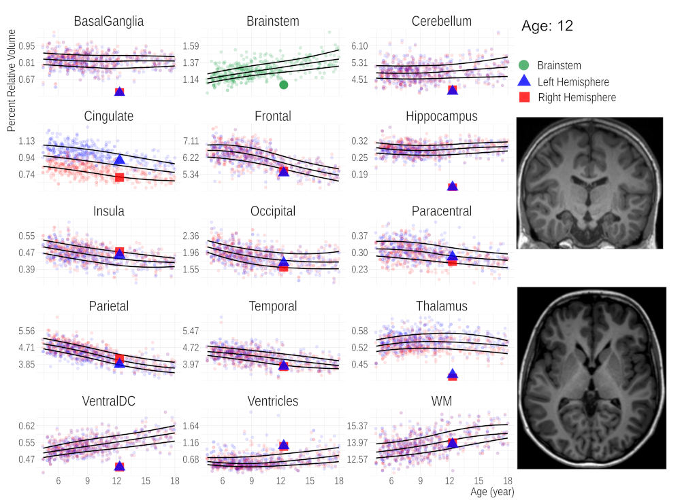

# KinderSeg: FastSurfer Database for Age-Specific Brain Volumes in Healthy Children


[](https://opensource.org/licenses/MIT)


### Code for the paper:
```
Zughayyar, I., Bauer, M., Güttler, C., de Almeida Marcelino, A.L., Kühne, F., Buss, C., Heim, C., Aigner, A., Tietze, A. and Dell'Orco, A. (2025), A FastSurfer Database for Age-Specific Brain Volumes in Healthy Children: A Tool for Quantifying Localized and Global Brain Volume Alterations in Pediatric Patients. Brain Behav, 15: e70689. https://doi.org/10.1002/brb3.70689

```
[](https://doi.org/10.1002/brb3.70689)
[](https://doi.org/10.5281/zenodo.12773962)



## Run with Docker 

```
git clone https://github.com/ibrazug/kinderseg.git
cd kinderseg/Docker
cp </path/to/your/license.txt> .
docker build -t kinderseg .
docker run --gpus all --rm \
    -v <nifti_data>:/data \
    -v <output_dir>:/output \
    kinderseg \
    --age <age> \
    --threads <threads, optional, default=4>
```
 IMPORTANT NOTE: --threads is used to define the number of threads in total. not per hemisphere. 


`nifti_data` can be either a directory containing NIfTI files or a single NIfTI file. The output will be saved in the `output` directory in a subdirectory named after the input NIfTI file, without the extension. Example:

```
docker run --gpus all --rm \
    -v $PWD/sub-001/ses-01/anat/sub-001_ses-01_T1w.nii.gz:/data/sub-001_ses-01_T1w.nii.gz \
    -v ./output:/output \
    kinderseg --age 12
```

## Run with Apptainer/Singularity

```bash
git clone https://github.com/ibrazug/kinderseg.git
cd kinderseg/Docker
cp </path/to/your/freesurfer/license.txt> .  # copy your FreeSurfer license into this folder
docker build -t kinderseg .
apptainer build kinderseg.sif docker-daemon://kinderseg:latest

# Run the container with proper mounting:
apptainer run --nv kinderseg.sif \
    -B <nifti_data>:/data \
    -B ./output:/output \
    --age 18 \
    --threads 14
````

**Notes:**

* Use relative paths (`./data`, `./output`) instead of `$PWD` to avoid mount errors.
* Bind all `-B` options **before** the image name (`kinderseg.sif`).


#### Requirements

- At least 5 GB of RAM
- GPU (optional, but recommended)
- a valid FreeSurfer license: you can get one for free by clicking [here](https://surfer.nmr.mgh.harvard.edu/registration.html).
- we also provided Docker.amd version for AMD chips. 


## Dataset Statistics

| Dataset      | N° in total | Ex (QC) | N° after QC | Ex (SC) | N° after SC |
|--------------|-------------|---------|-------------|---------|-------------|
| HBN          | 170         | 21      | 149         | 10      | 139         |
| LOC          | 125         | 32      | 93          | 1       | 92          |
| Kids2Health  | 211         | 5       | 206         | 1       | 205         |
| **Total**    | **506**     | **58**  | **448**     | **12**  | **436**     |


## MRI Segmentation and Volumetric Analysis of the dataset subjects

### MRI Post-processing
- DICOM data converted to NIfTI format using `dcm2niix` and  Python version 3.9 was used for data manipulation

### Segmentation Tools

1. **FreeSurfer v7.4:** Ran on a Slurm cluster with a 16-core Intel Xeon E5-2650 CPU, Utilized GNU Parallel for parallel processing

2. **FastSurfer v2.3.3:** Utilized FastSurferCNN pipeline on a workstation with an AMD 3970X CPU and NVIDIA GeForce RTX 3090 GPU


### Data Analysis


- R version 4.1.2  used for analysis
- Libraries: ggplot2, tidyverse, viridis (R)


## KinderSeg Module Files

The `kinderseg` directory contains the following key files and scripts:

1. **`metrics.py`**:  
   - Implements metrics and evaluation methods for comparing segmented brain volumes.  
   - Includes the `DiceNiiRois` class for calculating the Dice similarity coefficient between ROIs in NIfTI files.  
   - Outputs a Pandas DataFrame with the Dice similarity between all ROIs.  

2. **`sums.py`**:  
   - Contains utility classes for summarizing region of interest (ROI) data and volume tables.  
   - Classes:  
     - `SumNiiRois`: Summarizes ROIs as defined in the `sumroi_mapping.csv` file and generates output NIfTI files.  
     - `SumVolTable`: Summarizes volume tables (from FastSurfer and FreeSurfer) based on mapped ROIs, creating CSV output.  
   - Uses parallel processing to speed up calculations and ROI summarization.  

3. **`sumroi_mapping.csv`**:  
   - A CSV file that contains mappings between raw ROIs and summarized ROIs.  
   - Supports mappings from VINN and FreeSurfer 7 (FS7) formats.  
   - Used by `sums.py` to transform and summarize volume data efficiently.  


## Article Citation
To cite this work, please use the following reference:

```
Zughayyar, I., Bauer, M., Güttler, C., de Almeida Marcelino, A.L., Kühne, F., Buss, C., Heim, C., Aigner, A., Tietze, A. and Dell'Orco, A. (2025), A FastSurfer Database for Age-Specific Brain Volumes in Healthy Children: A Tool for Quantifying Localized and Global Brain Volume Alterations in Pediatric Patients. Brain Behav, 15: e70689. https://doi.org/10.1002/brb3.70689
```

```
@article{https://doi.org/10.1002/brb3.70689,
author = {Zughayyar, Ibrahim and Bauer, Martin and Güttler, Christopher and de Almeida Marcelino, Ana Luisa and Kühne, Fabienne and Buss, Claudia and Heim, Christine and Aigner, Annette and Tietze, Anna and Dell'Orco, Andrea},
title = {A FastSurfer Database for Age-Specific Brain Volumes in Healthy Children: A Tool for Quantifying Localized and Global Brain Volume Alterations in Pediatric Patients},
journal = {Brain and Behavior},
volume = {15},
number = {7},
pages = {e70689},
keywords = {automated segmentation, brain volumetry, FastSurfer, FreeSurfer, hemispheric asymmetries, neuroimaging, pediatric MRI},
doi = {https://doi.org/10.1002/brb3.70689},
url = {https://onlinelibrary.wiley.com/doi/abs/10.1002/brb3.70689},
eprint = {https://onlinelibrary.wiley.com/doi/pdf/10.1002/brb3.70689},
year = {2025}
}
```

```
TY  - JOUR
T1  - A FastSurfer Database for Age-Specific Brain Volumes in Healthy Children: A Tool for Quantifying Localized and Global Brain Volume Alterations in Pediatric Patients
AU  - Zughayyar, Ibrahim
AU  - Bauer, Martin
AU  - Güttler, Christopher
AU  - de Almeida Marcelino, Ana Luisa
AU  - Kühne, Fabienne
AU  - Buss, Claudia
AU  - Heim, Christine
AU  - Aigner, Annette
AU  - Tietze, Anna
AU  - Dell'Orco, Andrea
Y1  - 2025/07/01
PY  - 2025
DA  - 2025/07/01
DO  - https://doi.org/10.1002/brb3.70689
T2  - Brain and Behavior
JF  - Brain and Behavior
JO  - Brain and Behavior
JA  - Brain Behav
SP  - e70689
VL  - 15
IS  - 7
KW  - automated segmentation
KW  - brain volumetry
KW  - FastSurfer
KW  - FreeSurfer
KW  - hemispheric asymmetries
KW  - neuroimaging
KW  - pediatric MRI
PB  - John Wiley & Sons, Ltd
SN  - 2162-3279
UR  - https://doi.org/10.1002/brb3.70689
Y2  - 2025/08/08
```